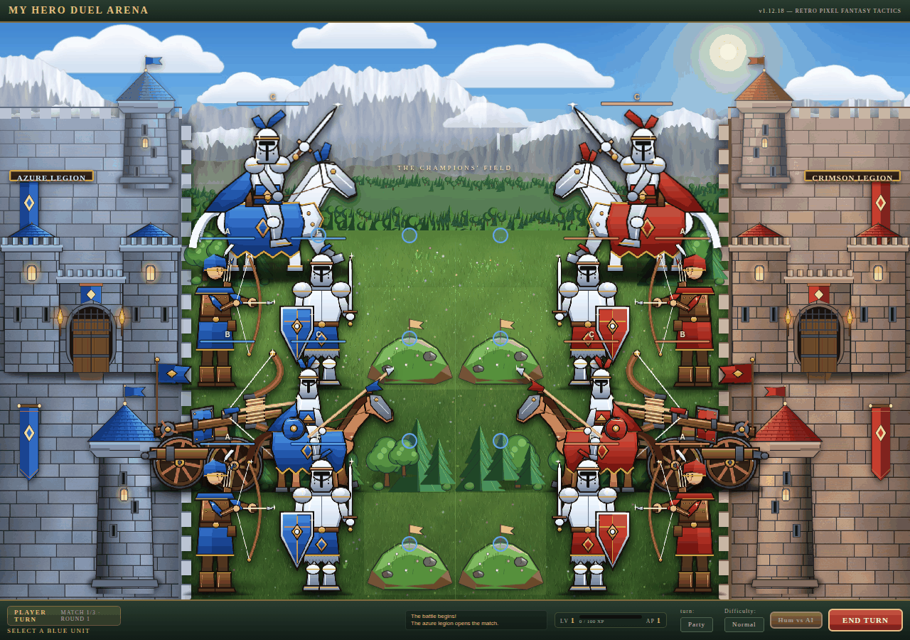

# myHeroDuelArena

A browser tactics duel. Two legions fight over a shared 10 × 4 field. The blue
legion is yours; the crimson legion is played by a deterministic tactical AI
that scores every legal action and takes the best one, and that plays sharper
the higher you turn the difficulty. You can also hand both legions to the AI
and watch the fight.



**Play it:** https://klas-gh.github.io/myHeroDuelArena/ (after the first deploy; see [Deploying](#deploying))

No build step, no dependencies, no network calls: `index.html` is the app.

## Run it locally

Open `index.html` in a browser, or serve the folder:

```
python -m http.server 8080      # then open http://localhost:8080
```

On Windows, `startSrvLocal.bat` does the same and opens the browser.

## How to play

1. Pick the difficulty and the turn mode (Party or Troop) in the footer, then press **START**.
2. Click a blue unit. Blue cells show where it can move, red units are what it can strike.
3. Click a cell to move, or an enemy to attack. A fighter gets **one action** per turn: move, attack, or brace.
4. Press **END TURN**. The crimson legion answers. Win two matches out of three to win the duel.

`quick_Guide.txt` has the same in a printable form. The **Hum vs AI / AI vs AI**
button switches between playing and spectating.

## The troops

| Troop | HP | ATK | DEF | Move | Weapon |
| --- | --- | --- | --- | --- | --- |
| Champion | 90 | 20 | 8 | 2 | Blade (charge) and a bow (16 ATK) |
| Footman | 60 | 12 | 6 | 1 | Blade |
| Chevalier | 55 | 16 | 5 | 3 | Blade (charge) |
| Ballista | 45 | 18 | 3 | 1 | Bolt, whole field |
| Archer | 40 | 14 | 4 | 2 | Bow, whole field |

## The rules

**The field** is 10 columns × 4 rows, but the fighting happens on columns 2 to 7:
the outermost starting column of each army is the edge of the field for *both*
armies, so nobody can walk behind the enemy's back rank (columns 0, 1, 8 and 9
are the strongholds, off limits to the fighters). Column 0 is the far left,
row 0 is the lowest row on screen. Blue deploys in columns 2 and 3, red deploys
in columns 6 and 7, and the columns between them are neutral ground. The
champion's two-column picture has to fit inside the field too.

**The armies** are seven fighters: a champion, two archers, a ballista, two
foot soldiers and a chevalier. The front rank — the foot soldiers and the
chevalier — stands one column closer to the enemy, and the champion stands in
its own column with the shooters behind it. Both sides deploy identically and
face the same kind of fighter in the same lane, and the terrain map is
mirrored around the centre line so neither side gets better ground.

**A turn** gives every living unit one action: move, attack, or brace behind
its shield (since v1.12.9 a fighter that moves cannot also attack). In *Party*
mode you act with the whole legion and then end the turn; in *Troop* mode each
fighter acts alone: after its action the crimson legion answers with one fighter
of its own, and the round closes when everybody has acted. Pressing END TURN by
hand in Troop mode means "I am done": the fighters that did not act hold their
ground. Ending the turn hands the field to the AI, which plays its turn and
returns control. The lead alternates from round to round: the azure
legion opens the first round, the crimson legion opens the second, and a round
is closed when the legion that answered has finished its turn.

**Distance** is octagonal. The longest axis decides, so a cell one column
and one row away is one step away. Movement, melee reach, weapon range and
ability radii all use that one rule.

**Attacks** come in two kinds. A bow (the archer's, the ballista's and the
champion's) covers the whole field: it lands on any living enemy, and neither
the distance, nor the ground in between, nor the rank the enemy stands in turns
the shot aside. A blade (the foot soldier's, the chevalier's and the champion's)
only cuts the cell next to it, and never backwards. The chevalier and the
champion may *charge*: they run to a free cell beside the target and strike,
from any distance, but only if they can actually walk there. Fighters and rocks
in the way stop a charge; one open lane is a way in. A fighter struck by a blade
answers once per round with a riposte at −25% damage.

**The pictures** on the field are the troops themselves: every fighter is
drawn as a large picture in the colour of its army. The picture always stands
on the ground line of the cell the fighter occupies, and the champion is drawn
across two columns without ever leaving its cell.

**Defeat** is permanent for the battle. A dead unit leaves the field and its
experience is paid out once.

**The round limit** is 30. No battle runs longer than that. The last round is
fought in sudden death, where every blow counts for 1.5× more, and a battle
that reaches the limit without an elimination is settled on the health each
army has left: the stronger army wins, an even field is a draw.

**The champion** is a stronger unit than the rest of the legion. It keeps the
same rules as everyone else, and it carries two weapons: its own blow (20 ATK
at arm's length) and a bow (16 ATK,
reaching the whole field) for when it would rather fight from a distance. Its three abilities are unlocked by progression rather
than by the battle:

| Ability | Unlocks | Cost | Effect |
| --- | --- | --- | --- |
| Rally Allies | level 1 | ability allowance | Adjacent allies gain +3 ATK and +2 DEF for one round. |
| Power Strike | level 2 | the attack action | A heavy melee blow that deals 8 extra damage. Two uses per battle. |
| Guarding Aura | level 3 | the whole turn | The champion and adjacent allies gain +3 DEF for two rounds. |

**Progression** is kept per browser. Experience is paid for the damage your
legion lands (one point for every five points of damage, overkill excluded),
for every defeated unit (15 to 60 depending on the kind, plus 40 more for the
enemy champion) and 50 for winning. Every level grants one ability point, and
levels 2 to 5 grant permanent HP, ATK and DEF bonuses. The `RESET` control in
the progression strip clears the profile, but asks for a confirmation first.

**The report** at the end of a battle shows what the fight was worth: the
rounds it lasted, the damage dealt and taken, the enemies felled, the friends
lost and the experience that was paid out, broken down into the damage, the
kills and the victory. Since v1.6.0 it also says how many units were left
standing, how much health was left on the field, what settled the fight
(`ELIMINATION`, `ROUND LIMIT` or `EVEN ARMIES`) and whether it was a player
battle or a watched one. Every reward is paid exactly once, however often the
end of the battle is checked.

**Spectating** puts both legions under AI control and takes the player out of
the fight. A watched battle is a display, not a battle the player took part
in, so it pays nothing at all: no experience, no rewards, no level and no
change to the saved profile.

## Project layout

| File | Purpose |
| --- | --- |
| `index.html` | The page: selector, battlefield, panels and the embedded SVG unit symbols. |
| `style.css` | All styling, including the responsive rules and the unit animations. |
| `game.js` | The whole game: rules, terrain, maps, difficulty, AI, rendering and persistence. |
| `assets/troops/` | The ten troop pictures, one per kind of fighter and colour. |
| `generate_troop_art.py`, `generate_game_art.py`, `gen_icons.py` | Scripts that draw the artwork and icons (Pillow). |
| `test_harness.js` | The DOM stub and sandbox loader shared by the test suites. |
| `regression.js` | Rule-level suite; drives the real engine through the harness. |
| `smoke_quick.js` | DOM and wiring suite; boots the real page in the stub. |
| `verify_render.js` | Render suite; drives the real page in headless Edge. |
| `balance.js` | Balance harness; plays seeded battles headlessly and reports the results. |
| `balance-*.json` | Saved balance measurements (see the changelog for which version each is from). |
| `CHANGELOG.md` | Every release, newest first. |
| `.github/workflows/pages.yml` | Runs the tests, then deploys to GitHub Pages. |

## Tests

The rule and DOM checks run on Node (22 or newer) without dependencies. The
render suite additionally needs Microsoft Edge.

```
node regression.js      # rules, terrain, maps, difficulty, progression, AI, round limit, spectator, charge, animation rule
node smoke_quick.js     # DOM wiring, stylesheet contract, runtime flow, damage numbers
node verify_render.js   # real rendering and real mouse input in headless Edge
node balance.js         # seeded balance measurement, JSON out
```

`regression.js` and `smoke_quick.js` load the shipped `game.js` into a
sandboxed DOM stub instead of re-implementing the rules, so a test cannot pass
while the game disagrees. Every suite prints `=== Results: N passed, M failed ===`
and exits non-zero on failure. Current counts: 932 rule assertions and 159 DOM assertions.

## Deploying

The game is static, so GitHub Pages hosts it as it is. The workflow in
`.github/workflows/pages.yml` runs the two Node suites and, if they pass,
publishes only the files the game needs. One-time setup: in the repository go to
**Settings → Pages → Build and deployment → Source** and choose **GitHub Actions**.
After that every push to `main` redeploys.

## Changelog

See [CHANGELOG.md](CHANGELOG.md).
